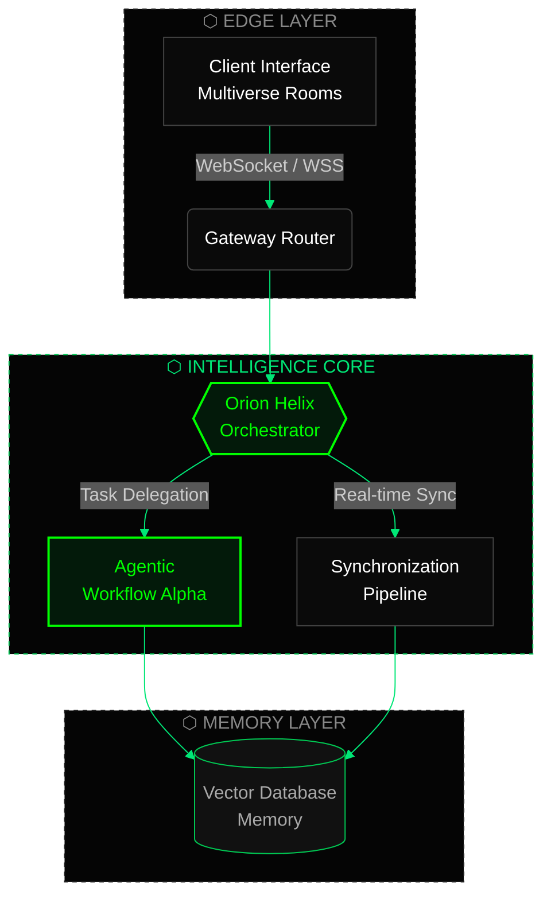

  

 

## ◈ Architecting the Autonomous Future

**SingularityHorizon Technologies Pvt. Ltd. (SiHo)** is the engineering core behind **Orion Helix AI**. Our repositories focus on building highly sensitive, proprietary intellectual property across **autonomous workflows**, **real-time synchronization**, and **collaborative enterprise environments**.

<table>
<tr>
<td width="33%" valign="top">

#### 🧠 Autonomous Agents
Agentic workflows delegated and coordinated by a central orchestration engine.

</td>
<td width="33%" valign="top">

#### ⚡ Real-Time Sync
Low-latency synchronization pipelines over secure, persistent WSS connections.

</td>
<td width="33%" valign="top">

#### 🏢 Enterprise Collaboration
Shared multiverse rooms built for teams, organizations, and secure workflows.

</td>
</tr>
</table>

---

## ◈ System Architecture: Orion Helix Flow

| Layer | Responsibility |
|---|---|
| **Edge** | Client interfaces and multiverse rooms connect through a secure gateway over WSS. |
| **Intelligence Core** | The orchestrator delegates tasks to agentic workflows and drives real-time synchronization. |
| **Memory** | Agents and sync pipelines persist and retrieve context from vector memory. |

---

## ◈ Repositories

| Repository | Purpose |
|---|---|
| 📖 [**orion-helix-docs**](https://github.com/SingularityHorizon/orion-helix-docs) | Official public documentation, API references, and integration guides for the Orion Helix autonomous engine. |
| 🔌 [**multiverse-rooms-sdk**](https://github.com/SingularityHorizon/multiverse-rooms-sdk) | Client-side SDKs and connection protocols for enterprise collaborative environments. |
| 🧬 [**enterprise-schemas**](https://github.com/SingularityHorizon/enterprise-schemas) | Public data structures and system architecture logic for agentic workflows. |
| ⚙️ [**.github**](https://github.com/SingularityHorizon/.github) | Official organization profile and configuration assets. |

---

## ◈ Core Capabilities

---

## ◈ Get Started

1. **Read the docs:** start with [`orion-helix-docs`](https://github.com/SingularityHorizon/orion-helix-docs).
2. **Integrate:** connect your client using [`multiverse-rooms-sdk`](https://github.com/SingularityHorizon/multiverse-rooms-sdk).
3. **Model your data:** use the structures in [`enterprise-schemas`](https://github.com/SingularityHorizon/enterprise-schemas).
4. **Talk to us:** partnerships and enterprise inquiries go to [singularityhorizon.hq@gmail.com](mailto:singularityhorizon.hq@gmail.com).

> 🔒 Our core engine and proprietary IP remain private. Public repositories contain documentation, SDKs, and schemas only.

---

© SingularityHorizon Technologies Pvt. Ltd. (SiHo). Architecting the Autonomous Future.

