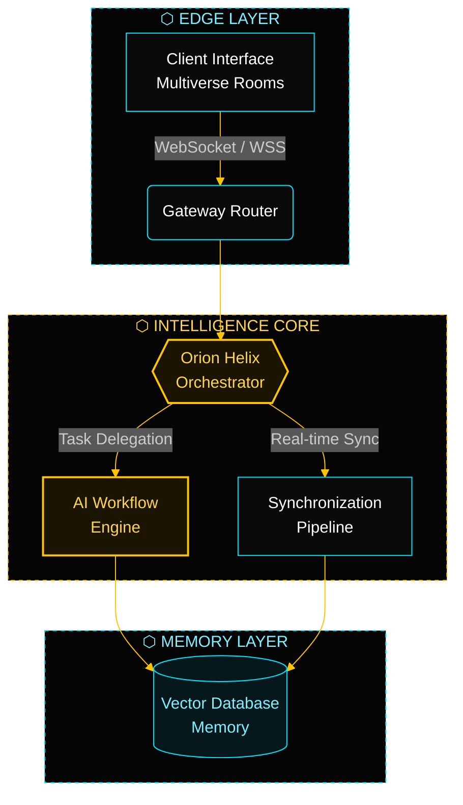

### Building Intelligence. Engineering Possibilities. Shaping Tomorrow.

  

 

## ◈ About SingularityHorizon

**SingularityHorizon Technologies Pvt. Ltd. (SiHo)** is an emerging technology company focused on building intelligent software systems, generative AI platforms, developer-centric technologies, and next-generation digital experiences.

We are the engineering core behind **OrionHelix AI**. Our focus is on engineering practical AI products, building scalable software infrastructure, and exploring new approaches to human-computer interaction. We aim to bridge the gap between advanced AI research and useful real-world applications.

<table>
<tr>
<td width="33%" valign="top">

#### 🧠 Generative AI
Intelligent platforms, AI-assisted workflows, and developer-focused AI tools.

</td>
<td width="33%" valign="top">

#### ⚡ Software Infrastructure
Scalable, modular systems with real-time synchronization and collaborative environments.

</td>
<td width="33%" valign="top">

#### 🌐 Digital Experiences
Interactive, spatial, and immersive interfaces built on modern web graphics.

</td>
</tr>
</table>

> 🔒 Our repositories focus on proprietary intellectual property across AI workflows, real-time synchronization, and collaborative enterprise environments. Core engine code remains private.

---

## ◈ Vision

We believe AI should become more accessible, useful, adaptable, and deeply integrated into everyday digital workflows. We are working toward a future where intelligent systems help developers, businesses, researchers, and individuals solve increasingly complex problems.

**Our long-term direction:**

- Generative AI platforms
- Intelligent developer environments
- Context-aware AI systems
- Retrieval-augmented generation
- Multimodal intelligence
- AI infrastructure and orchestration
- Human-AI collaboration
- Next-generation computing interfaces

These describe where we are heading. They are not claims about shipped products.

---

## ◈ Flagship Product: OrionHelix AI

**OrionHelix AI** is our flagship generative AI platform, built as an integrated AI environment where users interact with AI, generate content, work with development tools, and access AI-assisted workflows. Its long-term direction is an **AI Operating System (AOS)** that brings multiple AI capabilities together through one unified interface.

> **Status:** OrionHelix AI is currently a generative AI platform in active development. It is not a fully autonomous agentic system. Its present implementation includes workflow capabilities, a single model integration, and partially implemented memory functionality.

| Module | Focus | Status |
|---|---|---|
| **Core Platform** | Generative AI interactions, AI-assisted workflows, prompt engineering | 🟦 Active development |
| **Scribe** | AI-assisted writing and content generation | 🟦 Active development |
| **DevCore** | Developer-focused AI tooling | 🟦 Active development |
| **VisionCore** | Visual and multimodal AI exploration | 🟨 Exploration |
| **MotionCore** | Motion and generative media exploration | 🟨 Exploration |
| **Multiverse Room** | Collaborative interface and integrated canvas | 🟦 Active development |
| **Context and Memory** | Memory, knowledge graph exploration, RAG pipeline | 🟦 Partially implemented |

🟦 Active development · 🟨 Exploration. Statuses reflect current engineering direction, not launch commitments.

---

## ◈ Reference Architecture: Orion Helix Flow

The diagram below shows the **target architecture** we are building toward. Individual layers are at different stages of implementation.

| Layer | Responsibility |
|---|---|
| **Edge** | Client interfaces and multiverse rooms connect through a secure gateway over WSS. |
| **Intelligence Core** | The orchestrator coordinates AI workflows and drives real-time synchronization. |
| **Memory** | Workflows and sync pipelines persist and retrieve context from vector memory. |

---

## ◈ Technology Ecosystem

<table>
<tr>
<td width="50%" valign="top">

**Frontend Engineering**

</td>
<td width="50%" valign="top">

**Backend Engineering**

</td>
</tr>
<tr>
<td width="50%" valign="top">

**Databases and Infrastructure**

</td>
<td width="50%" valign="top">

**Graphics and Interactive Experiences**

</td>
</tr>
</table>

**Artificial Intelligence:** generative AI · large language models · prompt engineering · retrieval-augmented generation · embeddings · vector search · AI integration · multimodal AI exploration

Some technologies listed are areas of active use, others are areas of exploration. See individual repositories for what each project uses in practice.

---

## ◈ Other Engineering Initiatives

#### CampVion
An AI-assisted campus workflow platform focused on multi-step campus service processes.

- Python and FastAPI backend
- Next.js frontend
- Workflow execution with human approval mechanisms
- Structured API interactions

Repository link: *to be added once public.*

#### Experimental Engineering
We also explore AI-assisted development tools, intelligent automation, software engineering systems, interactive 3D experiences, and research-driven prototypes. Experimental work is not a commercially launched product.

---

## ◈ Engineering Philosophy

<table>
<tr>
<td width="20%" valign="top" align="center">

**Build With Purpose**

Solve meaningful problems through engineering.

</td>
<td width="20%" valign="top" align="center">

**Research Before Claims**

Value accuracy, experimentation, and measurable progress.

</td>
<td width="20%" valign="top" align="center">

**Open Engineering**

Learn, build, document, and share knowledge.

</td>
<td width="20%" valign="top" align="center">

**Scalable Architecture**

Maintainable software and modular systems.

</td>
<td width="20%" valign="top" align="center">

**Responsible Innovation**

Advancement paired with responsible development.

</td>
</tr>
</table>

---

## ◈ What We Are Building

| 🟦 Current Development | 🟨 Exploration and Research | 🟪 Long-Term Vision |
|---|---|---|
| OrionHelix AI generative AI platform | Advanced RAG architectures | Unified AI environments |
| AI-assisted developer experiences | Context-aware AI systems | Advanced human-AI collaboration |
| Core application infrastructure | Knowledge graph integration | More capable intelligent workflows |
| Interactive digital experiences | Multimodal AI | Next-generation AI infrastructure |
| CampVion engineering initiative | Improved AI orchestration and intelligent developer environments | |

No launch dates are implied. Items in later columns are not available today.

---

## ◈ Repositories

| Repository | Purpose |
|---|---|
| 📖 [**orion-helix-docs**](https://github.com/SingularityHorizon/orion-helix-docs) | Official public documentation, API references, and integration guides for the Orion Helix engine. |
| 🔌 [**multiverse-rooms-sdk**](https://github.com/SingularityHorizon/multiverse-rooms-sdk) | Client-side SDKs and connection protocols for enterprise collaborative environments. |
| 🧬 [**enterprise-schemas**](https://github.com/SingularityHorizon/enterprise-schemas) | Public data structures and system architecture logic for AI workflows. |
| ⚙️ [**.github**](https://github.com/SingularityHorizon/.github) | Official organization profile and configuration assets. |

---

## ◈ Open Engineering and Community

This GitHub organization is the central home for our company engineering repositories, AI product development, research experiments, developer tools, documentation, and open-source initiatives.

We invite developers, researchers, engineers, and technology enthusiasts to explore our repositories and collaborate where projects permit.

> Not every repository in this organization is open source. Each repository states its own license and contribution policy.

---

## ◈ Focus Areas

---

## ◈ Official Links

| | |
|---|---|
| 🌐 **Website** | [singularityhorizon.tech](https://singularityhorizon.tech) |
| 💻 **GitHub** | [github.com/SingularityHorizon](https://github.com/SingularityHorizon) |
| 💼 **LinkedIn** | [Company page](https://www.linkedin.com/company/YOUR-LINKEDIN-SLUG) |
| 🧠 **OrionHelix AI** | `ADD-PRODUCT-URL-WHEN-VERIFIED` |
| ✉️ **Contact** | [singularityhorizon.hq@gmail.com](mailto:singularityhorizon.hq@gmail.com) |

---

## ◈ Get Started

1. **Read the docs:** start with [`orion-helix-docs`](https://github.com/SingularityHorizon/orion-helix-docs).
2. **Integrate:** connect your client using [`multiverse-rooms-sdk`](https://github.com/SingularityHorizon/multiverse-rooms-sdk).
3. **Model your data:** use the structures in [`enterprise-schemas`](https://github.com/SingularityHorizon/enterprise-schemas).
4. **Talk to us:** partnerships and enterprise inquiries go to [singularityhorizon.hq@gmail.com](mailto:singularityhorizon.hq@gmail.com).

---

© SingularityHorizon Technologies Pvt. Ltd. (SiHo). Building Intelligence. Engineering Possibilities. Shaping Tomorrow.

